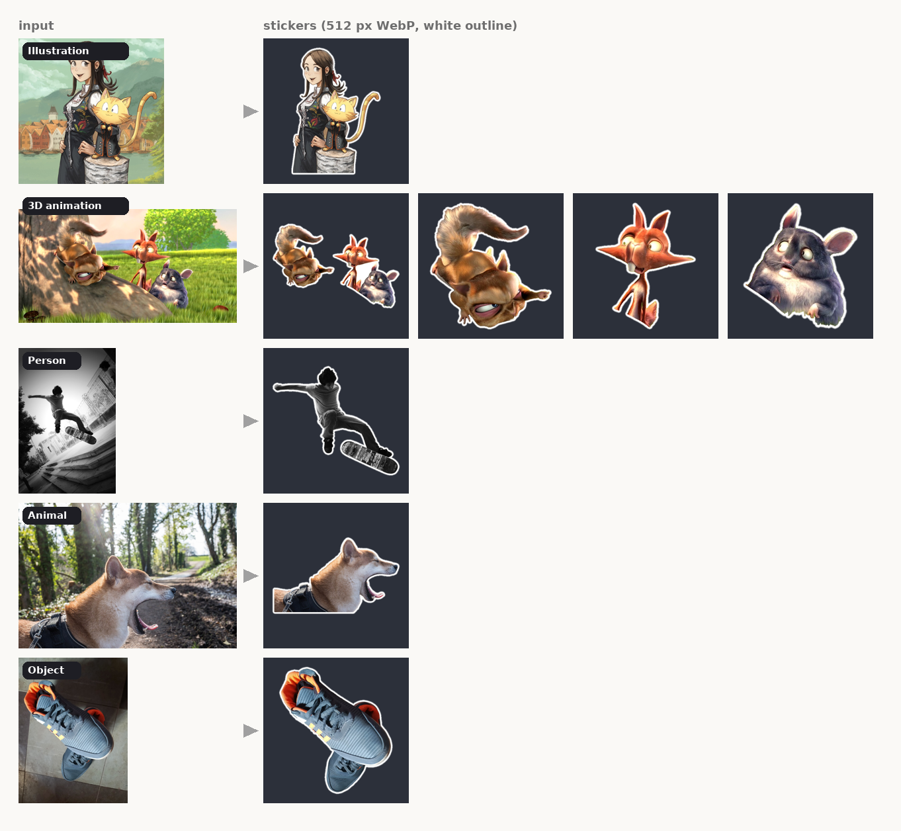

# sticker-kit

[](https://github.com/filep48/sticker-kit/actions/workflows/selftest.yml)


[](LICENSE)

Turn screenshots and photos into WhatsApp stickers by cutting out the real pixels.
No image generation, no account, no server. One Python file that any AI chat with a
code sandbox (Claude, ChatGPT, Gemini, ...) or any person with Python can run.



## Why

Asking a chatbot for "a sticker of this character" usually gets you a redrawn
lookalike. This kit keeps the original art: it finds the subject, removes the
background, adds the white outline WhatsApp stickers have, and exports files that
WhatsApp and sticker apps accept as they are.

## Use it from an AI chat

Paste this into any chat that can run code, together with your images:

```text
Download https://raw.githubusercontent.com/filep48/sticker-kit/main/sticker_kit.py,
run `python sticker_kit.py guide` and follow it to make stickers from my images.
```

If the sandbox has no internet, upload `sticker_kit.py` with your images and say
"run `python sticker_kit.py guide` and follow it". The guide inside the file tells the
AI the whole workflow, so it does not need this README. [HOW_TO_USE.md](HOW_TO_USE.md)
is the same in a few lines.

## Use it yourself

```bash
pip install -r requirements.txt
python sticker_kit.py selftest
python sticker_kit.py grid photo.jpg --out grid.png
python sticker_kit.py cut photo.jpg --box 80 440 1080 1340 --out skater
python sticker_kit.py sheet skater.png --out sheet.png
```

`grid` draws pixel coordinates over the image so you can pick the box. `cut` writes
`skater.png` and `skater.webp`. `sheet` shows the results on magenta and dark grey,
which makes leftovers and holes easy to spot.

## Two modes

| | model mode | classic mode |
|---|---|---|
| Needs | `pip install "rembg[cpu]"` and internet once (~1 GB model) | numpy, scipy, scikit-image, Pillow, OpenCV |
| Good for | photos, 3D renders, illustrations, anything | flat game art and cartoons |
| Speed | ~15 s per cut on a desktop CPU | under 2 s per cut |
| Picked | automatically when rembg is installed | automatically otherwise, or with `--classic` |

Model mode uses [BiRefNet](https://github.com/ZhengPeng7/BiRefNet) through
[rembg](https://github.com/danielgatis/rembg). Classic mode treats the colors that
touch the edge of your box as background (including their shadows) and refines the
result with OpenCV GrabCut. That is why the box matters more in classic mode.

## What it does

- **One sticker per character, plus the group.** Characters that touch each other
  are separated with seeds: a few points on each one (`--seeds`), then a watershed
  on the color gradient decides where one ends and the other starts. `--keep` picks
  who goes in the sticker.
- **Clean background from a second screenshot.** Games often give you two
  screenshots of the same scene. `--plate other.png` subtracts that frame and
  removes bushes, rocks and shadows that a model tends to keep.
- **Leftover colors.** `--key R,G,B` removes a known background color. Holes
  enclosed by the character are refilled, but never with a color you removed.
- **Logos and outlined drawings.** When an inner part has the same color as the
  background (a yellow wing on a yellow sign), the cut leaves it empty.
  `--fill-holes` puts the original pixels back in every enclosed area.
- **Clipping guard.** If the cut runs into the edge of the box, `cut` prints a
  warning: the subject is probably wider than the box.
- **WhatsApp-ready output.** 512 x 512 WebP under 100 KB, transparent, with the
  white outline at the same thickness whatever the source size.
- **Loose stickers and packs.** Every sticker comes as a PNG that WhatsApp's own
  sticker creator takes, no app needed. With 3 to 30, `pack` also builds a
  `.wastickers` file that sticker maker apps import in one go.

## Commands

| Command | Does |
|---|---|
| `guide` | Prints the workflow for an AI or a person |
| `selftest` | Checks the file and its dependencies on a synthetic scene, prints the mode |
| `grid IMAGE` | Coordinate grid to choose boxes and seeds |
| `cut IMAGE --box X0 Y0 X1 Y1 --out NAME` | One sticker. Options: `--seeds`, `--keep`, `--plate`, `--plate-box`, `--key`, `--tol`, `--fill-holes`, `--outline-width`, `--classic`, `--no-outline` |
| `sheet PNG...` | Review sheet |
| `pack WEBP... --title T --out F.wastickers` | WhatsApp sticker pack |

Seeds are JSON, one list of points per character:

```bash
python sticker_kit.py cut scene.png --box 180 40 1060 667 --out rinky \
  --seeds '{"frank": [[330,300],[400,370]], "rinky": [[700,200],[680,300]]}' --keep rinky
```

## Numbers

| | |
|---|---|
| Code | 1 file, ~530 lines, 5 core dependencies |
| Selftest | 8 checks, runs in CI on Python 3.10, 3.12 and 3.13 |
| Model mode | 13 to 23 s per cut (Intel i5-12600K, CPU only) |
| Classic mode | 0.5 to 1.6 s per cut on 1280 px images |
| Output | 512 x 512 WebP, 28 to 53 KB in the examples above |

## Limits

- A subject cut off by the edge of the photo keeps that straight edge.
- White clothes on a white background have no edge to find, in either mode.
- Classic mode is not meant for photos: busy backgrounds break its color logic.
- Seeds are needed whenever characters overlap. Black hair against black hair has
  no gradient, so put a seed on each one's hair.

## License

Free to use, change and share under the [GNU AGPL v3](LICENSE), with one extra
condition ([NOTICE](NOTICE)): keep the credit line

```text
Made with sticker-kit by filep48 (https://github.com/filep48/sticker-kit)
```

and show it wherever your users see legal notices, including any app or web page
built on this kit. If you run it as a service, AGPL means your users get your
source too.

Want it in a closed-source product, or without the credit? A commercial license is
available: [open an issue](https://github.com/filep48/sticker-kit/issues).

## Credits

Example images come from Wikimedia Commons under free licenses: Pepper&Carrot by
David Revoy (CC BY 4.0), Big Buck Bunny by the Blender Foundation (CC BY 3.0) and
three CC0 photos. Details in [CREDITS.md](CREDITS.md).

Only cut images you have the right to use, and keep sticker packs made from
copyrighted art for private chats.
